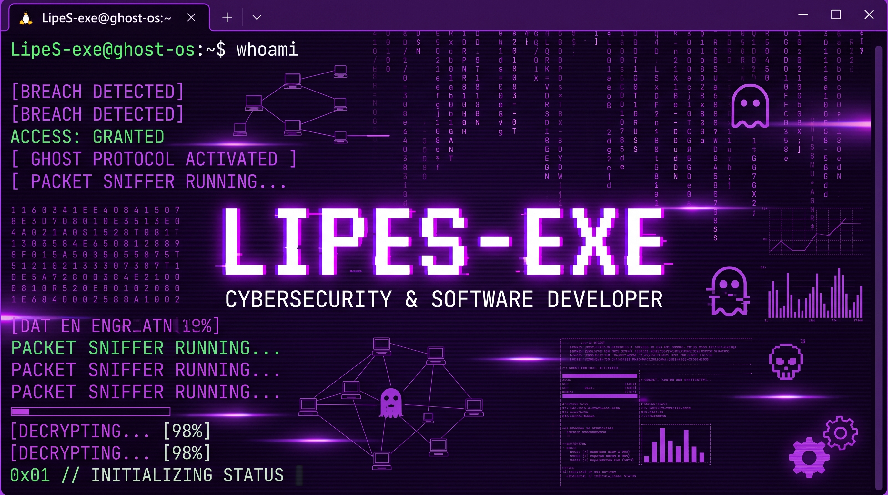

  

  

 

  

##  `[0x01] -> /whoami`

Estudante de Análise e Desenvolvimento de Sistemas (ADS) na Unimar, focado em **Arquitetura de Software**, **Web Pentesting (Red Team)** e **Automação de Testes (QA)**. Construindo soluções robustas desde o back-end até a automação da qualidade, sempre com uma mentalidade voltada para a segurança (Ghost Team 👻).

- **Estudando:** C# (ASP.NET Core), TypeScript, Python (FastAPI/Django) e Nuxt.
- **Foco Atual:** Segurança de APIs (OWASP), Design Patterns e Testes Automatizados (Cypress/Playwright).
- **Missão 2027:** Desenvolver a comunidade **G.P.U** (Ghost Protocol Unimar) e dominar arquiteturas escaláveis.

 

## `[0x02] -> /comunicacao`

  
  

 

  

## `[0x03] -> /stack_e_ferramentas`

  
  ### Back-end & APIs
  
  
  
  
  
  

  ### Front-end & UI
  
  
  
  

  ### QA & Cybersecurity
  
  
  
  

 

  

## `[0x04] -> /projetos`

| Projeto | Descrição | Stack | Status |
| :--- | :--- | :--- | :---: |
| **[CTF Pickle Rick](https://github.com/LipeS-exe/CTF-Relat-rio-Pickle-Rick)** | Relatório técnico (Write-up) de exploração de vulnerabilidades e escalonamento de privilégios. | `Pentest` `Red Team` | 🔴 Finalizado |
| **[Ransomware Dio](https://github.com/LipeS-exe/Ransomware-Dio)** | Simulação de script de Ransomware criada para estudos de malware e criptografia em Cibersegurança. | `Python` `Cybersec` | 🔴 Finalizado |
| **[ApexDrive](https://github.com/LipeS-exe/ApexDrive)** | API de revenda de veículos utilizando Repository Pattern e Injeção de Dependência. | `C#` `ASP.NET Core` | 🟢 Em dev |
| **[POO-SistemaBanco](https://github.com/LipeS-exe/POO-SistemaBanco)** | Sistema bancário desenvolvido com foco nos pilares da Programação Orientada a Objetos. | `POO` `Back-end` | 🔴 Finalizado |
| **[Projeto Final](https://github.com/LipeS-exe/ProjetoFinal)** | Projeto final da matéria Técnologias Front-end. | `Vue.js +  TailwindCSS` | 🔴 Finalizado |
| **[LeitorXML_](https://github.com/thiagodev1980/LeitorXML_)** | Módulo de processamento de notas fiscais (NFe) aplicando os princípios SOLID (Open/Closed). | `C#` | 🟡 Refatorando |

 

  

## `[0x05] -> /estatisticas_do_sistema`

 

  

 

  <i>"A segurança é um processo, não um produto." - Bruce Schneier</i>
    
  
  

